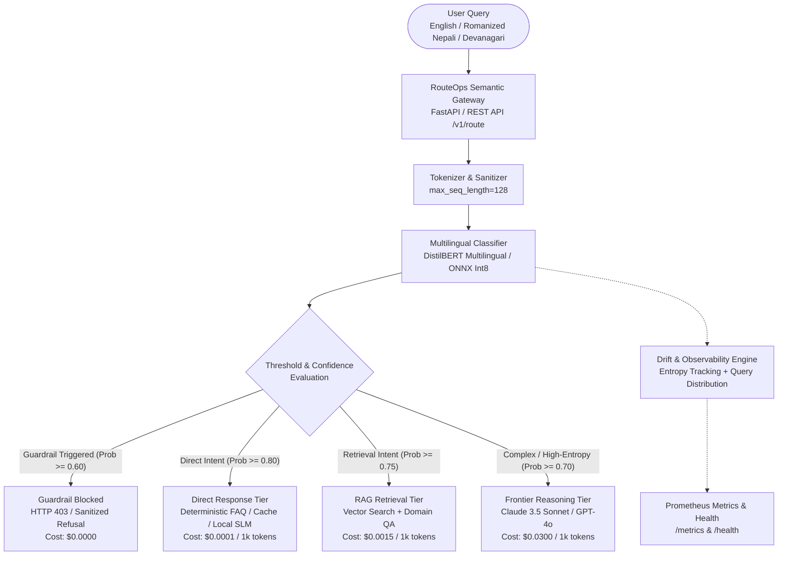

# RouteOps: Multilingual Semantic Router & Edge MLOps Gateway

[](https://routeops-nine.vercel.app)
[]()
[]()
[-orange.svg)]()
[-purple.svg)]()
[]()

> **[🌐 Live Interactive Demo & MLOps Playground: routeops-nine.vercel.app](https://routeops-nine.vercel.app)**

**RouteOps** is an enterprise-grade, cost-aware semantic router and inference gateway purpose-built for low-latency triage across multilingual workloads (English, Romanized Nepali `ne-rom`, and Devanagari Nepali `ne`). 

By categorizing incoming queries before dispatching them to LLMs, RouteOps protects operational budgets, prevents prompt injections, and minimizes inference latency by routing queries dynamically across **Direct Template Responses**, **RAG Retrieval**, or **Frontier Reasoning Engines**.

---

## Architecture Overview



### ASCII Architecture Representation

```text
+-----------------------------------------------------------------------------------+
|                           RouteOps Semantic Gateway                               |
|                                (FastAPI :8000)                                    |
+-----------------------------------------------------------------------------------+
                                         |
                       [ Incoming Multilingual Query ]
                      (English / Romanized Nepali / ne)
                                         |
                                         v
+-----------------------------------------------------------------------------------+
|               DistilBERT Multilingual Classifier (ONNX Int8 Runtime)              |
|                     P95 Latency < 15ms | Memory < 250MB                           |
+-----------------------------------------------------------------------------------+
                                         |
                       +-----------------+-----------------+
                       |                                   |
                       v                                   v
             [ Guardrail Filter ]                [ Semantic Route Decision ]
             (Prob >= 0.60 Flag)                 (Confidence Thresholds)
                       |                                   |
          +------------+------------+           +----------+-----------+
          |                         |           |                      |
          v                         v           v                      v
   [ 3: Blocked ]            [ 0: Direct ] [ 1: RAG ]          [ 2: Frontier ]
   Cost: $0.0000             Cost: $0.0001 Cost: $0.0015       Cost: $0.0300
          |                         |           |                      |
          +-------------------------+-----------+----------------------+
                                         |
                                         v
+-----------------------------------------------------------------------------------+
|               MLOps Observability & Drift Monitoring (Prometheus)                 |
|             - Query Latency Histogram    - Token Cost Savings Counter             |
|             - Prediction Drift Monitor   - Shannon Entropy Dispersion             |
+-----------------------------------------------------------------------------------+
```

---

## Edge Hardware Envelope & Constraints

RouteOps is explicitly architected and validated to run within strict consumer/edge workstation hardware constraints:

- **Host Processor**: Intel Core i5-12450H (8 Cores, 12 Threads)
- **Host Memory**: 16 GB DDR4/DDR5 System RAM
- **Dedicated Accelerator**: NVIDIA GeForce RTX 2050 (4096 MiB VRAM)
- **Training Budget Rule**: Strict **3.0 GB (3072 MiB)** maximum allocation during fine-tuning.
  - Achieved using:
    - FP16 mixed precision (`fp16=True`)
    - Compact sequence truncation (`max_length=128`)
    - Micro-batching (`per_device_train_batch_size=4`)
    - Gradient accumulation (`gradient_accumulation_steps=8` -> Effective batch size 32)
- **Serving Budget Rule**: 
  - Dynamic Int8 ONNX Runtime CPU quantization for zero-VRAM footprint during edge serving.
  - Sub-15ms P95 classification latency.

---

## Routing Tiers & Cost Optimization Matrix

| Route ID | Label | Intent Type & Trigger | Target Engine | Cost / 1k Tokens | Typical Savings |
| :---: | :--- | :--- | :--- | :---: | :---: |
| **0** | `direct_response` | Greetings, hours, chit-chat, static FAQs | Local Template / Cache | **$0.0001** | ~99.7% |
| **1** | `rag_retrieval` | Banking FAQs, civic info, Nepali documentation | Vector DB + Small Model | **$0.0015** | ~95.0% |
| **2** | `frontier_reasoning` | Multi-step reasoning, mathematical logic, code | Claude 3.5 / GPT-4o | **$0.0300** | Baseline |
| **3** | `guardrail_blocked` | Prompt injection, jailbreak attempts, toxic text | Gateway Refusal (403) | **$0.0000** | 100% |

---

## Project Structure

```text
routeops/
├── .claude/
│   └── agents/
│       └── git-shipper.md       # Specialized agent for Git hygiene & commits
├── configs/
│   └── config.yaml              # Unified configuration specification
├── src/
│   ├── __init__.py              # Package init & semantic version
│   ├── config.py                # Typed Pydantic configuration loader
│   ├── data_gen.py              # Multilingual synthetic dataset generator
│   ├── train.py                 # HF Trainer fine-tuning with VRAM guardrails
│   ├── export_onnx.py           # ONNX export & Int8 dynamic quantizer
│   ├── router_service.py        # Core semantic routing engine & fallback logic
│   ├── drift_monitor.py         # Real-time Shannon entropy & drift tracking
│   ├── api.py                   # FastAPI production gateway endpoints
│   └── smoke_test_4gb.py        # RTX 2050 4GB VRAM safety verification
├── tests/
│   └── test_smoke.py            # Latency, memory, and routing unit tests
├── CLAUDE.md                    # System operational instructions & constraints
├── Makefile                     # Build & automation commands
├── requirements.txt             # Project dependencies
└── README.md                    # Project documentation
```

---

## Quickstart & Installation

### 1. Prerequisites
- Linux OS with Python 3.10+
- Optional: NVIDIA RTX GPU with CUDA 12+ for training acceleration

### 2. Setup Environment
```bash
# Clone the repository
git clone https://github.com/Bishal-Stha/routeops.git
cd routeops

# Install dependencies
make install
```

### 3. Run Hardware Safety Smoke Test
Verify system hardware limits and ensure VRAM remains strictly under 3.0 GB:
```bash
make smoke-test
```

### 4. Fine-Tune Multilingual Classifier
Train `distilbert-base-multilingual-cased` on synthetic English and Romanized Nepali datasets:
```bash
make train
```

### 5. Export and Quantize to ONNX
Export the fine-tuned checkpoint to ONNX format and apply Int8 dynamic quantization:
```bash
make export-onnx
```

### 6. Start the Gateway API
```bash
python -m uvicorn src.api:app --host 0.0.0.0 --port 8000 --reload
```

---

## Example API Request

```bash
curl -X POST "http://localhost:8000/v1/route" \
     -H "Content-Type: application/json" \
     -d '{
       "query": "Namaste! Mero bank account ma balance kasari check garne?",
       "language_hint": "ne-rom"
     }'
```

### Response:
```json
{
  "query": "Namaste! Mero bank account ma balance kasari check garne?",
  "routed_class": "rag_retrieval",
  "confidence": 0.9412,
  "action": "route_to_rag",
  "estimated_cost_per_1k": 0.0015,
  "latency_ms": 8.42,
  "entropy": 0.284,
  "language_detected": "ne-rom"
}
```

---

## Testing & Quality Assurance

```bash
# Run unit test suite with coverage
make test

# Code formatting and static lint checks
make format
make lint
```

---

## Zero-Cost Live Deployment (Dual-Deploy Architecture)

RouteOps supports a dual-deploy architecture with instant frontend loading and zero cold starts:

### 1. Instant Frontend on Vercel (`ui/`)
Deploy the static dashboard to Vercel for instant sub-second edge delivery:
```bash
# Deploy to Vercel in 1 command
vercel --prod
```
The client-side engine automatically runs deterministic routing and PII masking if the backend container is spinning up.

### 2. Free 16GB RAM Backend on Hugging Face Spaces (Docker)
Push the quantized Int8 ONNX model and start the FastAPI gateway container:
```bash
# 1. Upload model to Hugging Face Model Hub
export HF_TOKEN="hf_your_token_here"
python scripts/deploy_hf.py --repo-id <your-username>/routeops-model

# 2. Deploy Docker Space on Hugging Face Spaces (Port 7860 default)
# Set Environment Variable on HF Space:
# HF_MODEL_REPO=<your-username>/routeops-model
```
The Docker container automatically downloads the quantized ONNX artifact on launch and exposes Swagger docs at `/docs` with full CORS support.

